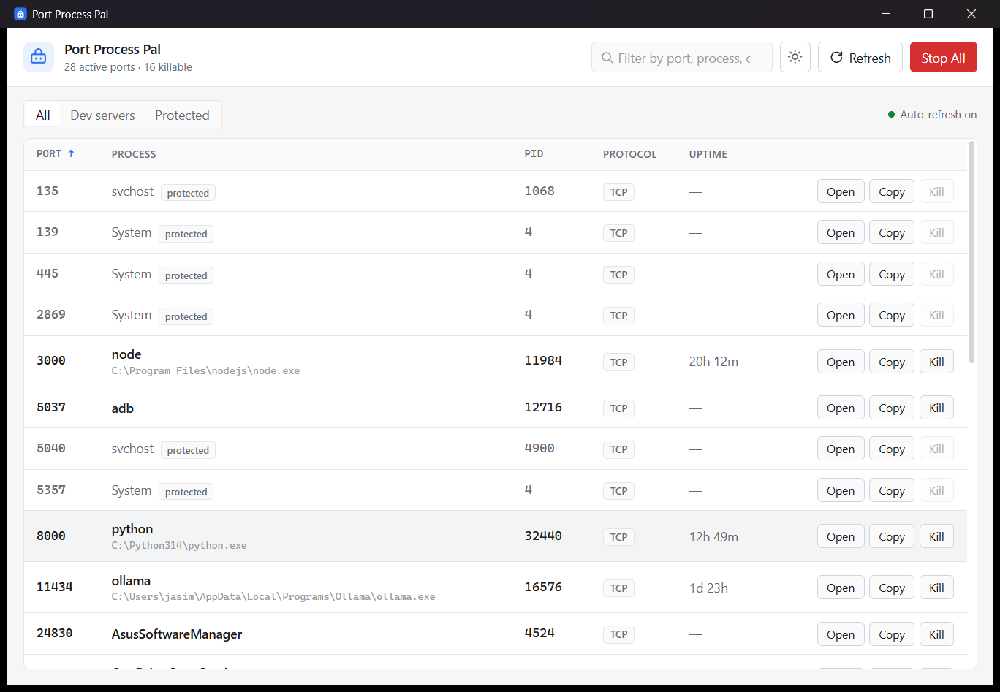
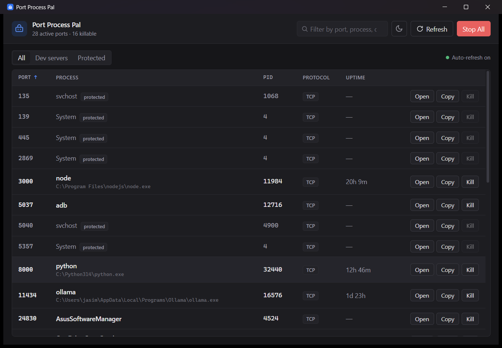

# Port Process Pal

**See every port in use on your machine, know what owns it, and reclaim it — one click or all at once.**

Port Process Pal (PPP) is a small, fast desktop app for the moment you realise
you’ve left three dev servers running and your new one just landed on `:3003`.
It lists every listening port, shows the owning process and how long it’s been
running, and lets you open it in a browser, copy its URL, or terminate it.



<details>
<summary>Dark theme</summary>



</details>

---

## The problem

If you live in a terminal, you know the drill: a Next.js server here, a Python
API there, a stray Docker container, an `ollama` you forgot about. Ports creep
upward (`:3000` → `:3001` → `:3002`…) and tracking down *which* process is
squatting on a port usually means a `netstat`/`lsof` incantation followed by a
manual `kill`.

PPP turns that into a glance and a click.

## Features

- **Live port list** — every TCP port in `LISTEN`, refreshed automatically every 2 seconds.
- **Owner at a glance** — process name, PID, executable path, and uptime (“running for 4h 12m”).
- **Open / Copy / Kill** per row — jump to `http://localhost:<port>`, copy the URL, or terminate the process.
- **Stop All** — clear out every dev server at once, behind a confirmation that shows exactly what will be terminated.
- **Safety rails** — privileged ports (`< 1024`) and well-known system processes are shown but marked **protected** and excluded from bulk actions. PID 0/1/4 and the app’s own process are never touched.
- **Search, filter & sort** — filter by port, process, or PID; narrow to dev servers or protected rows; sort any column.
- **Light & dark** — clean light theme by default, dark on request, follows your system on first launch.
- **Keyboard friendly** — `/` to search, `R` to refresh, `Esc` to clear/close.

## Supported platforms

| Platform | Status | How it reads ports |
| --- | --- | --- |
| **Windows 10/11** | ✅ Primary target | `Get-NetTCPConnection` + `Get-Process` |
| **macOS** | ✅ Supported | `lsof -nP -iTCP -sTCP:LISTEN` + `ps` |
| **Linux** | ✅ Supported | `lsof -nP -iTCP -sTCP:LISTEN` + `ps` |

## Install

Grab the latest installer from the [Releases](https://github.com/JasimSiddiqui/port-process-pal/releases) page.

- **Windows:** run the `.exe` installer. The app isn’t code-signed yet, so
  Windows SmartScreen may warn you. Click **More info → Run anyway**.
- **macOS:** open the `.dmg` and drag the app across. Because it isn’t notarized
  yet, macOS may block the first launch — **right-click the app → Open**, then
  confirm. (You only need to do this once.)

> Code signing and notarization are planned; until then the workarounds above
> are expected for any unsigned app.

## Build from source

You’ll need [Node.js](https://nodejs.org) 18+, the
[Rust toolchain](https://rustup.rs), and the
[Tauri prerequisites](https://tauri.app/start/prerequisites/) for your OS
(on Windows: the **MSVC C++ build tools** and the **WebView2** runtime, which
ships with Windows 11).

```bash
git clone https://github.com/JasimSiddiqui/port-process-pal.git
cd port-process-pal
npm install

# Run in development (hot-reloads the frontend)
npm run dev

# Produce an installer for your platform
npm run build
```

Installers land in `src-tauri/target/release/bundle/`.

## How it works

PPP is a [Tauri 2](https://tauri.app) app: a small Rust core wrapped around a
native system WebView, with a plain HTML/CSS/JavaScript frontend — no framework,
no bundler.

- The **Rust backend** ([`src-tauri/src/ports.rs`](src-tauri/src/ports.rs))
  shells out to the OS, parses the output into a typed `PortInfo` list, and
  exposes four commands: `list_ports`, `kill_process`, `kill_all`, and
  `open_in_browser`. Every command branches per-OS with `cfg!(target_os = …)`
  and is written so a single unparseable row can’t take down the whole list.
- The **frontend** ([`src/main.js`](src/main.js)) calls those commands over
  Tauri’s `invoke` bridge, polls every 2 seconds, and reconciles the table by a
  `port-pid` key so rows update in place instead of flickering. Kills are
  optimistic — the row fades immediately and the next poll confirms the truth.

The result is a single window that starts instantly and weighs a few megabytes.

## Tech stack

- **[Tauri 2](https://tauri.app)** — desktop shell (Rust + system WebView)
- **Rust** — port enumeration and process control
- **Vanilla HTML/CSS/JS** — the UI, kept deliberately light

## License

Released under the [MIT License](LICENSE).
